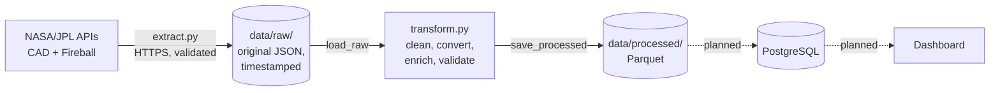

# Asteroids Project: a Planetary Defense ETL Pipeline

An ETL pipeline that collects, cleans and enriches public NASA/JPL data about two things most people never hear about: asteroids that pass close to Earth, and space rocks that actually explode in our atmosphere.

> **Status: work in progress.** Extraction and transformation are done and tested. Loading into PostgreSQL, scheduling and a dashboard are next (see [Roadmap](#roadmap)). The repository is public from the start on purpose, so the development history is visible.

---

## Why this project

Two facts motivated the choice of data:

- **Most asteroids that pass closer than the Moon are only discovered after they have already passed.** In 2023, 53.9% of the known sub-lunar-distance flybys were found after closest approach, and only 1.7% were found more than a week in advance ([Wikipedia, compiled from MPC/JPL data](https://en.wikipedia.org/wiki/List_of_asteroid_close_approaches_to_Earth_in_2023)).
- **Small asteroids hit the atmosphere all the time, and the measurements come from military early-warning satellites.** NASA's fireball dataset is built from U.S. Government sensors and reports each event's energy in kilotons of TNT ([CNEOS](https://cneos.jpl.nasa.gov/fireballs/)). For scale, the 2013 Chelyabinsk event over Russia released about 440 kt ([CNEOS](https://cneos.jpl.nasa.gov/news/fireball_130301.html)).

The goal is a pipeline that keeps this information up to date and turns raw API responses into data a person can actually read: distances in lunar distances instead of astronomical units, sizes in meters instead of magnitudes, energy in joules and kilotons.

---

## Data sources

Both APIs are public, free and need no API key.

| Dataset | API | What one row is | Nature of the data |
|---|---|---|---|
| **CAD** (Close-Approach Data) | [`ssd-api.jpl.nasa.gov/cad.api`](https://ssd-api.jpl.nasa.gov/doc/cad.html) | One close approach of a known asteroid or comet to Earth, past or predicted | A snapshot that **changes**: orbits are recomputed as new observations arrive |
| **Fireball** | [`ssd-api.jpl.nasa.gov/fireball.api`](https://ssd-api.jpl.nasa.gov/doc/fireball.html) | One bolide that brightened and broke up in the atmosphere | An append-only event log: old events don't change, new ones arrive |

In short: CAD is about **near misses**, Fireball is about **actual hits**. The first extraction (November 2026) returned 1,245 close approaches within 10 lunar distances (from one year back to 60 days ahead) and the full fireball history of 1,074 events.

Full column descriptions, units and validation rules are in [`DATA_DICTIONARY.md`](DATA_DICTIONARY.md).

---

## Architecture



```
Asteroids-Project/
├── extract.py              # Extraction: API calls, raw layer, incremental load
├── transform.py            # Transformation: pipeline version (functions)
├── transform_layout.ipynb  # Transformation done by hand, cell by cell
├── tests/
│   ├── test_extract.py     # 30 tests (functional + security)
│   └── test_transform.py   # 88 tests (functional + validation + security)
├── DATA_DICTIONARY.md      # Every column: type, unit, origin, meaning
├── requirements.txt        # Runtime dependencies
└── requirements-dev.txt    # Runtime + test and security tools
```

---

## Extraction (`extract.py`)

- **Raw layer.** Every API response is saved untouched as JSON in `data/raw/<source>/`, named by UTC timestamp. Transformations can be re-run without calling the API again, and every row keeps its lineage (`_extracted_at`, `_api_version`, `_raw_file`).
- **Incremental load.** Fireball stores the date of the latest event in `data/state.json` and only asks for newer events on the next run. Because the API filter is inclusive, the last event comes back once and is removed in the transformation.
- **No type conversion here.** The API returns numbers as strings; extraction keeps them as they are and leaves conversion to the transformation step.

**Security measures**, all covered by tests:

| Risk | Mitigation |
|---|---|
| Talking to the wrong server | HTTPS only, a single allowed host, a fixed list of endpoints, redirects refused, TLS verification always on |
| Parameter injection (`10LD&limit=999999`) | Parameters validated with a strict pattern before building the URL; dates must be `date` objects |
| Hanging or huge responses | Connect/read timeouts and a 25 MB response limit, enforced while streaming |
| API silently changes format | Response must be JSON with a `NASA/JPL` signature, API version 1.x and every required field; otherwise extraction fails loudly |
| Temporary server errors | Retries with exponential backoff, only on 429/5xx (never on client errors) |
| Corrupted files after a crash | Atomic writes (temporary file + rename) |
| Tampered raw files | `load_raw` only reads files with the pipeline's own naming pattern and re-validates the schema |

---

## Transformation

The transformation exists in two forms, on purpose:

- **[`transform_layout.ipynb`](transform_layout.ipynb)** is the transformation written **by hand**, cell by cell, while exploring the data. It is kept exactly as it was written, including its rough edges, because it shows the reasoning process.
- **[`transform.py`](transform.py)** is the same logic organized as reusable, tested functions for the pipeline (`transform_cad`, `transform_fireball`, `save_processed`), with extra validation.

### CAD

- Strips padding from designations and names, keeping internal spaces (`"  (2025 VV2)"` → `"(2025 VV2)"`).
- Parses the calendar date with an explicit format (`2026-May-01 21:48`), never by guessing.
- Converts distance from astronomical units to **kilometers** and **lunar distances**.
- Measures **orbit uncertainty**: the width of the 3-sigma distance interval in km and as a percentage.
- Computes **escape velocity** at each approach, the **speed gained from Earth's gravity**, and flags objects that were **gravitationally bound** to Earth.
- Parses the time uncertainty (`"2_09:42"` = 2 days, 9 h, 42 min) into minutes, keeping a flag for the `"< 00:01"` lower bound.
- Estimates **diameter** from absolute magnitude (min, typical and max), and builds a "best available" size that uses the measured diameter when it exists.
- Splits the full name into number, proper name and provisional designation.

### Fireball

- Turns the separate hemisphere columns into **signed coordinates** (`41.8 S` → `−41.8`), ready for a map.
- Converts radiated energy (reported in units of 10¹⁰ J) and impact energy (kilotons) to **joules**.
- **Deduplicates** events repeated by the incremental load, always keeping the most recent extraction.
- Renames columns to `snake_case` (`impact-e` → `impact_e`) so they can be loaded into SQL.

### Data quality

`transform.py` validates its own output and raises an error instead of producing wrong data. Examples: every nominal distance must lie inside its own uncertainty interval; distances and velocities must be finite and positive; coordinates must be valid latitudes and longitudes; and **no value present in the raw text may silently turn into a null during conversion**. The full list of rules is in the data dictionary.

---

## Physics notes

These are the observations made while transforming the data. They are what turned the project from a cleaning exercise into something worth reading.

### Why some `v_inf` values are null: a temporary minimoon

The CAD API reports two velocities: `v_rel`, the speed relative to Earth at closest approach, and `v_inf`, the speed the object would have far from Earth. They are linked by conservation of energy:

$$v_{\infty}^{2} = v_{rel}^{2} - v_{esc}^{2}, \qquad v_{esc} = \sqrt{\frac{2\,GM_{\oplus}}{r}}$$

In the first extraction, only two rows had a null `v_inf`, and both belonged to the same object, **2026 QQ8** (roughly 1.4–3.2 m across). At those two approaches its speed relative to Earth was **lower than the escape velocity at that distance**:

| Approach | Distance | `v_rel` | Escape velocity | `v_inf` |
|---|---|---|---|---|
| 2026-05-01 | 3.01 LD | 0.795 km/s | 0.831 km/s | null (bound) |
| 2026-08-18 | 1.40 LD | 1.146 km/s | 1.218 km/s | null (bound) |
| 2026-12-13 | 3.52 LD | 0.797 km/s | 0.768 km/s | 0.212 km/s (escapes) |

With $v_{rel} < v_{esc}$, the equation gives a negative $v_{\infty}^2$: the object did not have enough energy to leave, so there is no "speed at infinity" and the API returns null. The null is not missing data; it **is** the information. The transformation keeps it and adds the `is_gravitationally_bound` flag instead of dropping or filling it.

The December row works as a consistency check: solving the same equation for the distance using only the two velocities gives about 1.35 million km, or 3.52 lunar distances, which matches the distance the API reports for that row.

I could not find any publication about this object, so whether it is a natural rock or an old rocket stage (artificial objects sometimes show up with Earth-like orbits) remains an open question.

### Uncertainty shrinks near the observations

The same object shows how orbit uncertainty works. The 3-sigma distance interval is about **714 km wide** for the May approach, which happened months before the object was discovered and had to be computed backwards, but only about **15 km wide** in August, when it was being observed. Same object, same orbit, an uncertainty almost 50 times smaller. As new observations come in, the `orbit_id` changes and these intervals shrink, which is why tracking orbit versions over time is on the roadmap.

### Size from brightness

Only 1 of the 1,245 approaches had a measured diameter. For all others, size is estimated from the absolute magnitude $H$ and an assumed albedo $p$ (how much light the surface reflects) ([CNEOS](https://cneos.jpl.nasa.gov/tools/ast_size_est.html)):

$$D_{km} = \frac{1329}{\sqrt{p}} \times 10^{-H/5}$$

Using $p$ from 0.25 (bright) to 0.05 (dark) gives a size range; 0.14 gives a central estimate. For $H = 22$ the range is about 106 to 237 m, with a central value near 140 m, the size used to define potentially hazardous asteroids ([CNEOS](https://cneos.jpl.nasa.gov/about/neo_groups.html)). These estimates depend on an assumption and are labeled as such (`has_measured_diameter`).

### Other details worth knowing

- CAD times are in **TDB** (Barycentric Dynamical Time), which differs from UTC by about a minute. They are intentionally stored without a timezone.
- Fireball `energy` is the **light** emitted, in units of 10¹⁰ J. `impact_e` is the **total** impact energy, estimated from it with an empirical formula, so it is always larger and is an estimate.
- Fireball latitude and longitude arrive as absolute values plus a hemisphere letter; locations are either fully known or fully null.

---

## Testing

The project has **118 automated tests** (30 for extraction, 88 for transformation). None of them touches the internet: they use synthetic data in the exact API format, including real values such as the 2026 QQ8 approaches. A fixture blocks any network call that tries to escape.

Besides functional checks, the tests cover security and robustness: parameter injection, refused redirects, oversized and malformed responses, path traversal when saving files, SQL/HTML-like strings passing through untouched, a 50,000-character input designed to cause catastrophic regex backtracking ([ReDoS](https://owasp.org/www-community/attacks/Regular_expression_Denial_of_Service_-_ReDoS)), and extreme values such as `inf` and `1e308`.

```bash
python -m pytest -q                       # all tests
bandit -q -r extract.py transform.py      # static security analysis
pip-audit -r requirements.txt             # known vulnerabilities in dependencies
```

---

## How to run

Requires Python 3.11+.

```bash
git clone https://github.com/RafaelGuimaraens/Asteroids-Project.git
cd Asteroids-Project
python -m venv .venv
```

Activate the environment:

```powershell
# Windows (PowerShell)
Set-ExecutionPolicy -Scope Process -ExecutionPolicy RemoteSigned
.venv\Scripts\Activate.ps1
```

```bash
# macOS / Linux
source .venv/bin/activate
```

Then:

```bash
pip install -r requirements-dev.txt   # or requirements.txt to run only
python extract.py                     # calls the NASA/JPL APIs and fills data/raw/
```

```python
from extract import load_raw
from transform import transform_cad, transform_fireball, save_processed

cad = transform_cad(load_raw("cad", mode="latest"))
fireball = transform_fireball(load_raw("fireball", mode="all"))

save_processed(cad, "cad")            # data/processed/cad.parquet
save_processed(fireball, "fireball")  # data/processed/fireball.parquet
```

`data/` is in `.gitignore`: data is always regenerated from the APIs, never committed.

---

## Skills demonstrated

| Area | What was used |
|---|---|
| **Data engineering** | ETL design, raw/processed layers, data lineage, incremental loading, idempotent deduplication, atomic writes, Parquet |
| **Python & data** | pandas (type conversion, vectorized operations, regex extraction, deduplication), NumPy, `requests`, `pathlib` |
| **APIs** | REST/JSON, query parameters, HTTP status codes, retries with backoff, timeouts, schema validation |
| **Data quality** | Explicit parsing formats, fail-loudly conversions, physics-based consistency checks, reasoning about why data is missing before handling nulls |
| **Security** | Input validation, injection and path traversal prevention, TLS, response size limits, ReDoS awareness, Bandit, pip-audit |
| **Testing** | pytest, fixtures, parametrization, monkeypatching, network isolation |
| **Physics & astronomy** | Orbital energy and escape velocity, Julian Dates and TDB, astronomical units and lunar distances, absolute magnitude and albedo, 3-sigma uncertainty, TNT-equivalent energy |
| **Documentation** | Data dictionary, units in column names, English documentation |

---

## Use of AI

This project was developed **with the help of AI**. Especially in the transformation step, I tried to do as much as possible by hand, which is why [`transform_layout.ipynb`](transform_layout.ipynb) is kept exactly as I wrote it.

---

## Roadmap

- [x] Extraction with raw layer, incremental load and security checks
- [x] Transformation (by hand in the notebook, then as tested functions)
- [x] Automated tests, static security analysis and dependency audit
- [ ] Load into PostgreSQL
- [ ] Orbit versioning: keep every `orbit_id` change to show how uncertainty shrinks over time
- [ ] Scheduling (cron or Airflow) and `docker compose up` for one-command setup
- [ ] Continuous integration with GitHub Actions
- [ ] Dashboard: close approaches vs. atmospheric impacts, map of fireballs, uncertainty over time

---

## Limitations

- Most sizes are estimates based on an assumed albedo, not measurements.
- TDB times are not converted to UTC; the difference is about one minute.
- The fireball dataset only includes events detected by U.S. Government sensors and is not a complete list of all impacts.
- The nature of 2026 QQ8 (natural or artificial) is not confirmed.

---

## Data credits

Data from NASA/JPL's [Center for Near Earth Object Studies (CNEOS)](https://cneos.jpl.nasa.gov/) and [Solar System Dynamics group](https://ssd.jpl.nasa.gov/), via the [SSD/CNEOS APIs](https://ssd-api.jpl.nasa.gov/). Fireball data is provided by U.S. Government sensors and reported by CNEOS. This project is not affiliated with NASA or JPL.

## Author

**Rafael Guimaraens**: Data Science and Machine Learning student at UniCEUB (Brasília, Brazil).
[GitHub](https://github.com/RafaelGuimaraens) · [LinkedIn](https://www.linkedin.com/in/rafael-guimaraens-84a4a9443)
